# Tutorial: Write a prototype prompt for Google Stitch, Lovable and similar platforms

This tutorial shows you how to use the **Prototype Prompt Builder** to turn your UX research into a clear prompt. You then paste the prompt into an AI prototyping platform, such as **Google Stitch** or **Lovable**, to make a clickable prototype for user testing.

All the screenshots use the same example: **StudySpot**, an app that helps students find a free study room on campus.

**Time needed:** about 20–30 minutes, if your research is ready.

---

## 1. Before you start

The builder **doesn't do your UX thinking for you**. It asks for things you should already have from earlier work. Before you start, you need:

- **User research**: interviews, surveys or observation notes showing a real problem
- **At least one persona**: a named user with goals and frustrations, based on your research
- **A journey map**: the steps your persona goes through now, with the pain points marked
- **User stories**: written as *"As a… I want… so that…"*
- **Wireframes**: paper or digital sketches of your main screens and how they link

Where this fits in the design process:

> Research → Personas → Journey map → User stories → Wireframes → **Prompt + prototype** → User testing → Iterate

> **Tip:** Keep these documents open beside the builder. You'll copy from them into almost every box.

---

## 2. Open the builder

Open the Prototype Prompt Builder in **Chrome, Edge or Safari**. These browsers support voice dictation.

The page has two halves:

- **Left:** six numbered steps to fill in.
- **Right:** your prompt. It updates as you type.

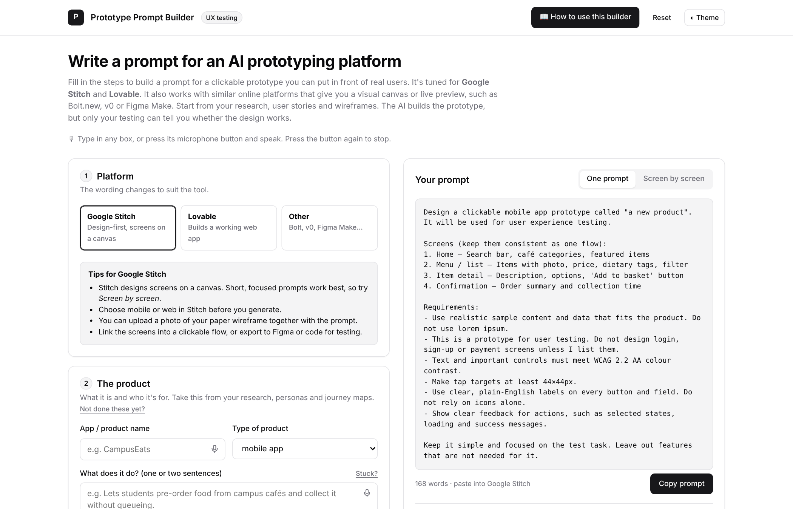

> **Note:** The example screens in step 3 (Home, Menu / list…) are only there to show you the format. Replace them with your own.

---

## 3. Check you're ready

Click **📖 How to use this builder** in the top bar. The instructions open in a new tab, so you won't lose anything you've typed.

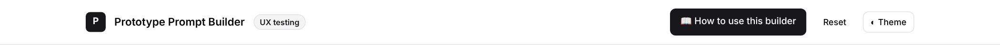

At the top of the instructions page, tick off each item you have. If you can't tick them all, finish your research first. Otherwise the AI will fill the gaps with guesses.

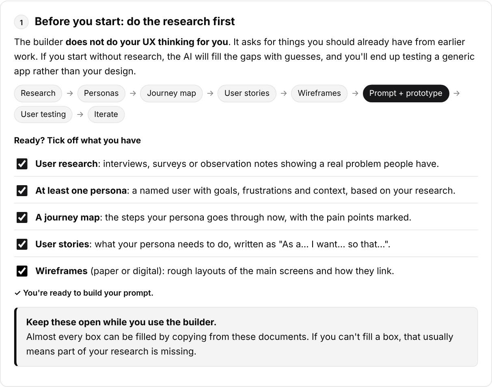

Switch back to the builder tab when you're ready.

---

## 4. Choose your platform

In **step 1**, choose the platform you'll use:

| Option | Choose it when… |
|---|---|
| **Google Stitch** | You're designing screens on a canvas. Stitch creates designs you can link and export. |
| **Lovable** | You want a working web app with real buttons, forms and a shareable link. |
| **Other** | You're using a similar platform (Bolt.new, v0, Figma Make…). Type its name in the box. |

The wording of your prompt changes to suit the platform, and a **Tips** box appears with advice for that tool.

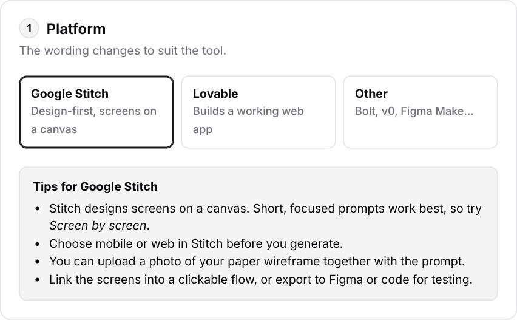

---

## 5. Describe the product

**Step 2** is the most important part. Take every answer from your research.

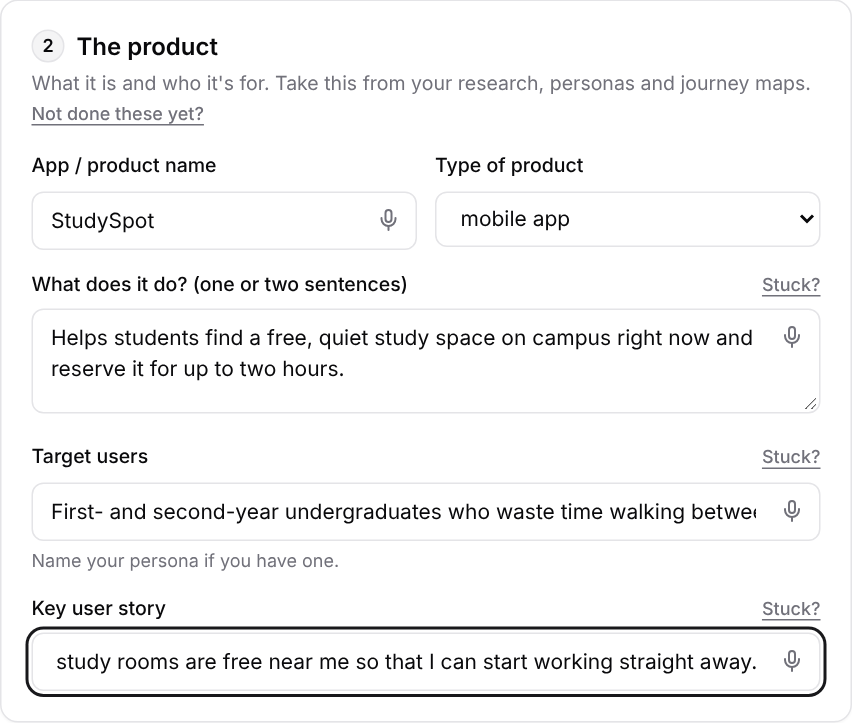

| Box | What to write | StudySpot example |
|---|---|---|
| **App / product name** | A working name | StudySpot |
| **Type of product** | Mobile app, website, dashboard… | mobile app |
| **What does it do?** | One or two sentences: *who* it helps, *what* they do, *why* it matters | Helps students find a free, quiet study space on campus right now and reserve it for up to two hours. |
| **Target users** | From your persona. Describe their *situation*, not just their age | First- and second-year undergraduates who waste time walking between buildings looking for somewhere quiet to work |
| **Key user story** | The **one** story your prototype must prove works | As a student with a free hour, I want to see which study rooms are free near me so that I can start working straight away. |

### Stuck? Use the hints

Next to the harder boxes there's a **Stuck?** link. It opens help with a fill-in-the-blank pattern and weak and better examples side by side.

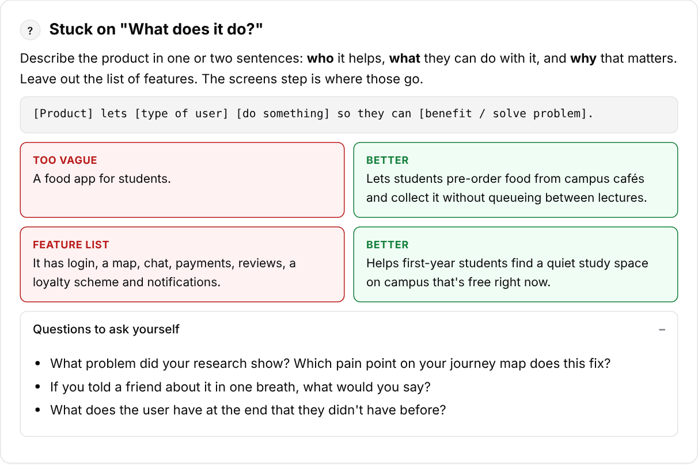

### Speak instead of typing

Every box has a **microphone** button. Press it and speak. It turns red while it's listening. Press it again to stop. Your words are added to anything you've already typed.

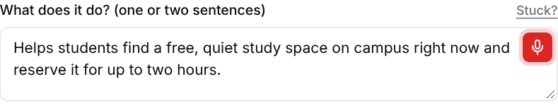

> **Microphone not working?** Allow microphone access when the browser asks. If it still doesn't work, use your computer's own dictation: **Windows + H** on Windows, or press **Fn** twice on a Mac.

---

## 6. List your screens

In **step 3**, list the screens a user moves through to complete your key user story, **in order**. Use your wireframes. Each step on your journey map often becomes a screen.

- **First box:** a simple screen name, e.g. *Home*, *Room list*.
- **Second box:** the main content and the main button on that screen.
- Use **+ Add screen** to add more, and **✕** to remove one.
- About **3–6 screens** is right. More than that and the result is more likely to be muddled.

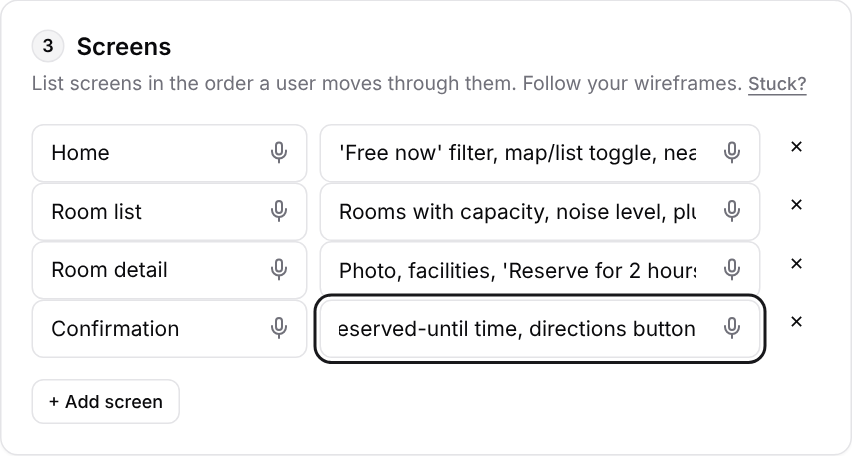

---

## 7. Write the test task

In **step 4**, describe what testers will try to do. The prototype has to let them finish this task.

- **Task(s) for testers:** give them a realistic goal, but don't tell them which buttons to press.
- **Interactions that must work:** list every click needed to finish the task, so the AI doesn't leave dead buttons.

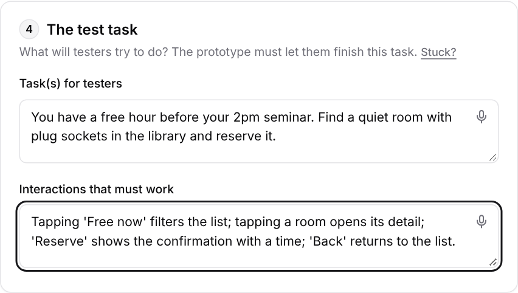

| ❌ Gives the answer away | ✅ Better |
|---|---|
| Click "Free now", tap the first room, press "Reserve". | You have a free hour before your 2pm seminar. Find a quiet room with plug sockets in the library and reserve it. |

---

## 8. Set the look and feel

In **step 5**, choose a design system and describe the style using your mood board or brand guidelines.

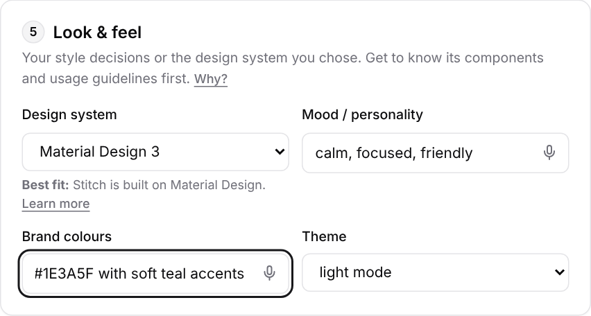

### Understand your design system first

A **design system** is a set of interface components (buttons, inputs, menus, dialogs, tabs and so on) with **guidelines for how and when to use each one**. The AI will place components, but it can't tell whether it chose the right one. That's your job. Before you prototype, read your design system's component pages and its "usage" or "do and don't" guidance.

### Read the hint under the menu

The hint changes depending on your platform and the system you choose:

- **Google Stitch:** every choice is a *style hint*. Stitch copies the look but draws its own components. **Material Design 3** is the best fit because Stitch is built on it.
- **Lovable:** a React-based library (shadcn/ui, Material via MUI, Ant Design, Fluent, Carbon, Bootstrap) gives you *real components*. shadcn/ui is Lovable's default.
- **Apple Human Interface Guidelines:** a *style reference* only on both platforms, because it's guidelines, not code.

Here's the same step with **Lovable** and **Ant Design** chosen:

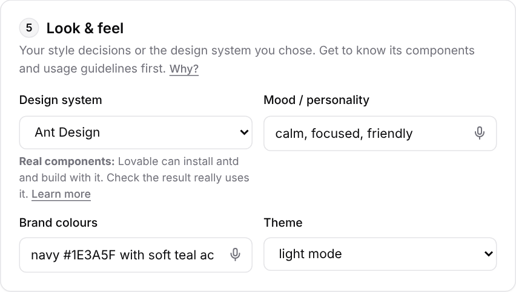

> **Not sure?** Choose *Let the platform choose* and describe the mood and colours instead.

---

## 9. Testing and accessibility options

**Step 6** adds rules that keep the prototype focused and testable. **Leave the ticked options on** unless you have a good reason to change them.

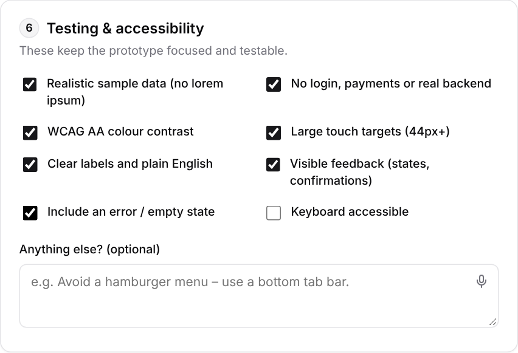

| Option | Why it matters |
|---|---|
| Realistic sample data | Testers react to real-looking content, not *lorem ipsum* |
| No login, payments or real backend | Stops the AI wasting time and credits on features you aren't testing |
| WCAG AA colour contrast | Text and buttons can be read by more people |
| Large touch targets (44px+) | Buttons are easy to tap on a phone |
| Clear labels and plain English | Testers aren't left guessing what icons mean |
| Visible feedback | Testers can see that their tap did something |
| Error / empty state *(optional)* | Lets you test what happens when things go wrong |
| Keyboard accessible *(optional)* | Important for web apps. Ignored for Stitch |

Use **Anything else?** for extra instructions, e.g. *"Use a bottom tab bar, not a hamburger menu."*

---

## 10. Read and copy your prompt

Look at the **Your prompt** panel on the right. **Read it through.** Does it describe *your* design? If not, change the boxes on the left. The prompt updates straight away.

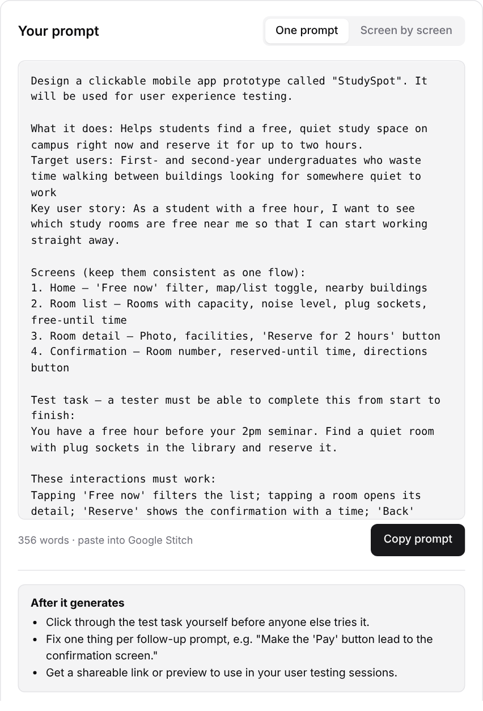

### One prompt or screen by screen?

| Tab | Use it for |
|---|---|
| **One prompt** | Everything in one message. Start with this in **Lovable**. |
| **Screen by screen** | A set of shorter prompts to paste one at a time. Often works better in **Stitch**, or whenever one big prompt gives a muddled result. |

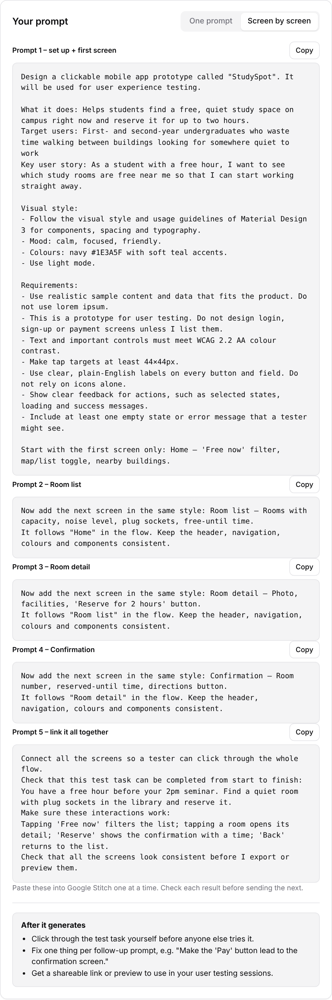

### Copy it

Click **Copy prompt** (or **Copy** next to each block in Screen by screen). A **Copied to clipboard** message appears at the bottom right.

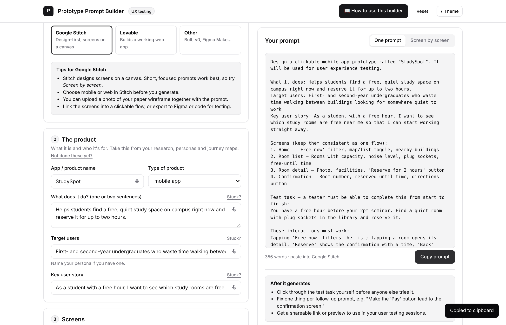

<details>
<summary><strong>See the full StudySpot prompt</strong></summary>

```text
Design a clickable mobile app prototype called "StudySpot". It will be used for user experience testing.

What it does: Helps students find a free, quiet study space on campus right now and reserve it for up to two hours.
Target users: First- and second-year undergraduates who waste time walking between buildings looking for somewhere quiet to work
Key user story: As a student with a free hour, I want to see which study rooms are free near me so that I can start working straight away.

Screens (keep them consistent as one flow):
1. Home – 'Free now' filter, map/list toggle, nearby buildings
2. Room list – Rooms with capacity, noise level, plug sockets, free-until time
3. Room detail – Photo, facilities, 'Reserve for 2 hours' button
4. Confirmation – Room number, reserved-until time, directions button

Test task – a tester must be able to complete this from start to finish:
You have a free hour before your 2pm seminar. Find a quiet room with plug sockets in the library and reserve it.

These interactions must work:
Tapping 'Free now' filters the list; tapping a room opens its detail; 'Reserve' shows the confirmation with a time; 'Back' returns to the list.

Visual style:
- Follow the visual style and usage guidelines of Material Design 3 for components, spacing and typography.
- Mood: calm, focused, friendly.
- Colours: navy #1E3A5F with soft teal accents.
- Use light mode.

Requirements:
- Use realistic sample content and data that fits the product. Do not use lorem ipsum.
- This is a prototype for user testing. Do not design login, sign-up or payment screens unless I list them.
- Text and important controls must meet WCAG 2.2 AA colour contrast.
- Make tap targets at least 44×44px.
- Use clear, plain-English labels on every button and field. Do not rely on icons alone.
- Show clear feedback for actions, such as selected states, loading and success messages.
- Include at least one empty state or error message that a tester might see.

Keep it simple and focused on the test task. Leave out features that are not needed for it.
```

</details>

---

## 11. Paste it into the platform

### Google Stitch

1. Go to **stitch.google.com** and sign in with a Google account.
2. Choose **mobile** or **web** to match your product type.
3. Paste your prompt into the prompt box. You can also attach a photo of your paper wireframe.
4. Send it. Stitch shows your prompt in the chat panel on the left while it generates the screens on the canvas.

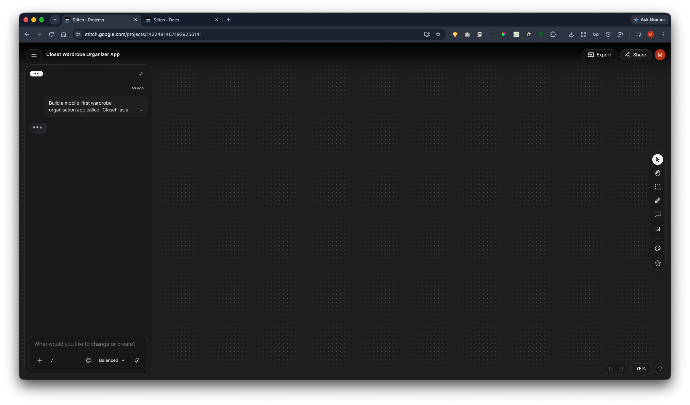

If you used **Screen by screen**, wait for each screen to finish before pasting the next prompt.

### Lovable

1. Go to **lovable.dev** and sign in.
2. Paste your prompt into the chat box on the home page and send it.
3. Wait for the preview to build, then click through it.
4. Click **Publish** when you want a link testers can open on their phones.

### Other platforms

Most similar platforms work in the same way: paste the prompt, send it, check the preview. Start with **One prompt**. If the result gets muddled, switch to **Screen by screen**.

> **Free plans have limits.** Each message uses up credits. Spend time getting the prompt right in the builder first, because that costs nothing.

---

## 12. After it generates

1. **Try the test task yourself.** Can you finish it without getting stuck?
2. **Fix one thing per message**, e.g. *"Make the 'Reserve' button go to the confirmation screen."* Several changes in one message often break other things.
3. **Check accessibility:** contrast, text size and clear labels.
4. **Check the components against your design system's guidelines.** Is each one the right component, used the right way, with all its states?
5. **Get a shareable link** (Lovable: *Publish*; Stitch: preview or export) for your testing sessions.
6. **Test with real users**, write down what happens, and go back to your design.

> The AI can build a prototype, but **only testing with real users** tells you whether it's useful, usable and valuable.

---

## 13. Common problems

| Problem | What to do |
|---|---|
| **The result looks generic and nothing like my wireframes** | Add more detail to the screen descriptions, attach your wireframe image (Stitch), or switch to *Screen by screen*. Make your *What does it do?* and *Target users* answers more specific. |
| **Buttons don't do anything** | List them in *Interactions that must work*, or send a follow-up such as *"When I tap 'Reserve', show the confirmation screen."* |
| **It added login screens or a database** | Check *No login, payments or real backend* is ticked, then send: *"Remove the login screen. This is a prototype for user testing only."* |
| **The microphone doesn't work** | Use Chrome, Edge or Safari, allow microphone access, and open the builder from its web address rather than as a file on your computer. Or use your computer's own dictation. |
| **I've run out of credits** | Copy your prompt and try another similar platform. Choose *Other* in step 1 and type its name. |
| **I lost my work** | The builder doesn't save automatically. Keep a copy of your prompt in a document before you close the tab. |

---

*Nothing you type into the Prototype Prompt Builder leaves your browser.*
